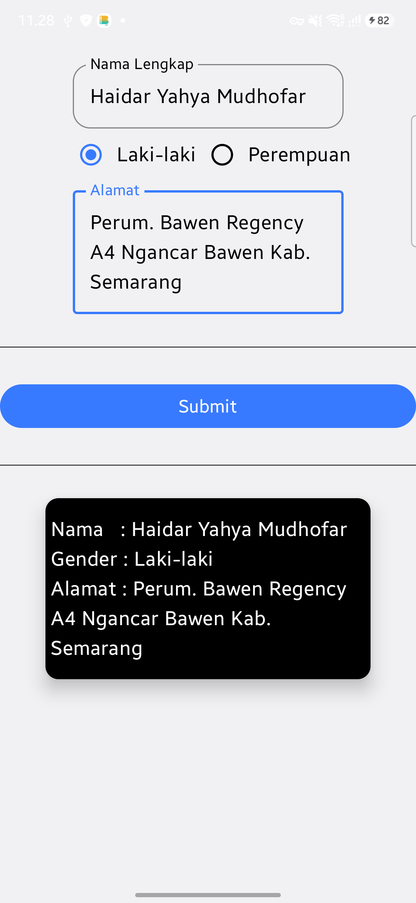

# Pertemuan 5 - Aplikasi Form Data Diri

Aplikasi Android sederhana berbasis **Jetpack Compose** untuk menginput dan menampilkan data diri (Nama Lengkap, Jenis Kelamin, dan Alamat).

---

## 📱 Tampilan Aplikasi

Berikut adalah tampilan dari aplikasi Form Data Diri setelah data dimasukkan dan tombol **Submit** ditekan:

<p align="center">
  
</p>

---

## ✨ Fitur Utama

1. **Input Nama Lengkap**: Field `OutlinedTextField` untuk memasukkan nama pengguna.
2. **Pilihan Jenis Kelamin**: Pilihan `RadioButton` untuk menentukan jenis kelamin (*Laki-laki* atau *Perempuan*).
3. **Input Alamat**: Field `OutlinedTextField` multiline untuk memasukkan alamat tempat tinggal.
4. **Validasi Tombol Submit**: Tombol **Submit** secara otomatis hanya akan aktif jika seluruh field (Nama, Gender, dan Alamat) telah diisi.
5. **Kartu Hasil Output (`ElevatedCard`)**: Menampilkan ringkasan data diri yang telah dimasukkan setelah tombol Submit diklik.

---

## 🛠️ Teknologi & Tools

- **Bahasa Pemrograman**: Kotlin
- **UI Framework**: Jetpack Compose
- **Design System**: Material Design 3 (`Material3`)
- **Min SDK**: Android 8.0 (API Level 26)
- **IDE**: Android Studio

---

## 📁 Struktur Kode Utama

```
app/src/main/java/com/example/pertemuan5/
├── MainActivity.kt    # Main Activity & entri utama UI aplikasi
└── Act5.kt            # Composable function FormDataDiri (State & UI Form)
```

---

## 🚀 Cara Menjalankan Proyek

1. **Clone Repository**:
   ```bash
   git clone <URL_REPOSITORY>
   ```
2. **Buka Proyek**: Buka direktori proyek ini menggunakan **Android Studio**.
3. **Sync Gradle**: Tunggu proses *Gradle Sync* selesai.
4. **Run Project**: Jalankan aplikasi pada Emulator Android atau Perangkat Fisik (Device) dengan menekan tombol **Run (Shift + F10)**.
